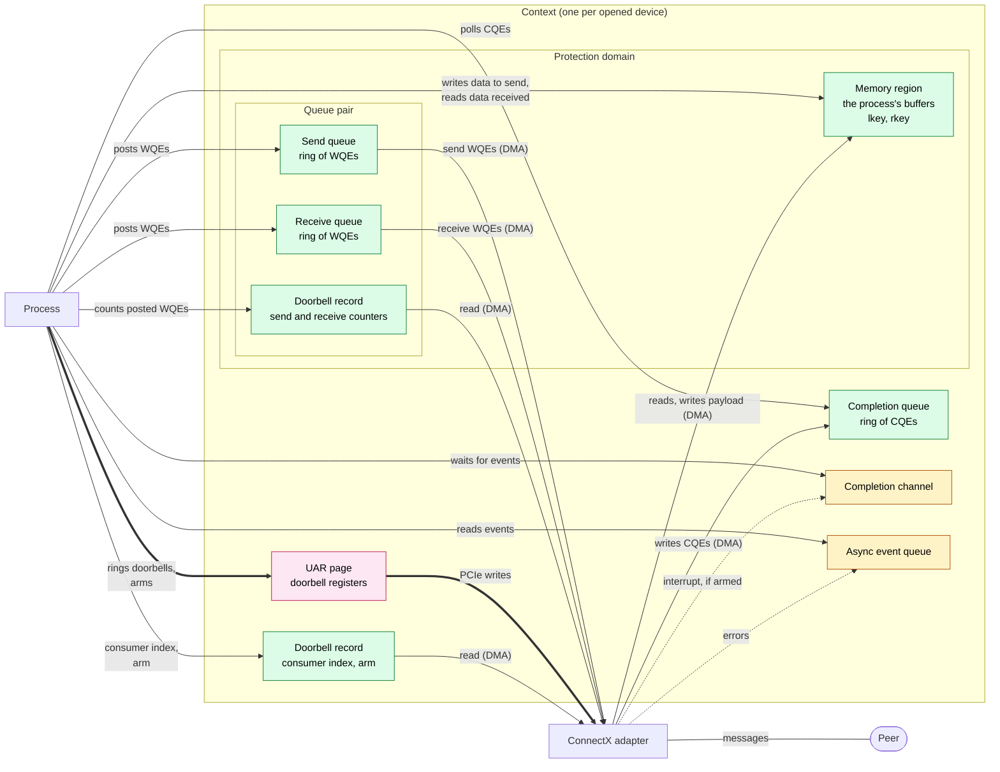

# mlx5

mlx5 is the driver for NVIDIA (Mellanox) ConnectX-4 and later adapters. Unlike
rxe, the adapter does the RDMA work itself, in hardware: it reads the process's
queues and buffers by DMA, and the kernel is only involved in setting things up
and in delivering events.

## Resources and how they interact

| Color | Resource | Memory |
|---|---|---|
| Green | Memory region, queues, doorbell records | The **process's own memory**, pinned by the kernel when the object is created, so the adapter can reach it by DMA. The queues live here too: the process allocates them, unlike with rxe. |
| Pink | UAR page | **The adapter's registers**, mapped into the process. Writing to them is not a memory access but a message to the adapter over PCIe. |
| Yellow | Completion channel, async event queue | **File descriptors**. The process reads events from them, which blocks until one arrives. |

Thick arrows are writes to the adapter's registers: ringing a doorbell and
arming a completion queue. Nothing on the data path enters the kernel, not
even arming.

## The resources

- **Context, protection domain, memory region:** the same as for every RDMA
  device. The kernel pins the memory region and gives the adapter its pages.
- **Queue pair:** its send and receive queues live in one buffer the process
  allocates. Send WQEs are made of 64-byte blocks: a WQE spans as many as its
  segments need, and wraps around the end of the ring. Receive WQEs all have
  the same size, chosen when the queue pair is created.
- **Doorbell record:** a few bytes of process memory the adapter reads: for a
  queue pair, how many WQEs were posted to each queue; for a completion
  queue, how far the process consumed it and how it was armed. It tells the
  adapter how far it may go, without the process waiting for the adapter.
- **UAR page:** a page of the adapter's registers. A write to its doorbell
  register wakes the adapter up for a queue pair or a completion queue.
- **Completion queue:** a ring of 64-byte CQEs. It has no producer index:
  each CQE carries an **owner bit**, which the adapter flips on every pass
  around the ring, so the process can tell a new CQE from one it already
  consumed.
- **Completion channel and async event queue:** the same as for every RDMA
  device. The adapter raises an interrupt, and the kernel turns it into an
  event on the right file descriptor.

## How work flows

- **Posting receives** writes WQEs into the receive queue and counts them in
  the doorbell record. That's all: the adapter reads the counter when a
  message arrives.
- **Posting sends** writes WQEs into the send queue, counts them in the
  doorbell record, then rings the doorbell register in the UAR page to wake
  the adapter. All three are plain writes, with no kernel call.
- **The order matters.** The adapter reads the queues on its own schedule, so
  every WQE must be fully in memory before the counter says it's there, and
  the counter before the doorbell. On arm64 the CPU may otherwise reorder
  these writes, so the process puts memory barriers between them.
- **The adapter** fetches the WQEs, reads the payload from the memory region
  by DMA, and sends it. Incoming data is written straight into the receiving
  side's memory region.
- **Completions:** the adapter writes a CQE for each finished WQE and flips
  its owner bit. A CQE names the queue pair and the position of its WQE, but
  not the WRID: the process keeps the WRIDs of its posted WQEs and looks them
  up.
- **Polling** reads CQEs whose owner bit says they are new, then writes the
  new consumer index into the completion queue's doorbell record, which
  frees the slots for the adapter to reuse.

## Waiting for completions

The steps are the same as for every RDMA device, but arming is done by the
process itself:

1. **Arm** the completion queue: write the arm command into its doorbell
   record, then ring the completion queue doorbell in the UAR page. Each arm
   carries a sequence number, which advances after every event, so the
   adapter can tell a new arm from a repeated one.
2. **Poll** once more, to catch CQEs that arrived before arming.
3. **Wait** on the completion channel. When the next CQE arrives, the adapter
   raises an interrupt, and the kernel reports the completion queue on its
   channel.
4. **Poll** to drain the completion queue, then arm again: an armed
   completion queue fires only once.

If a queue pair fails, it moves to the error state, its outstanding WQEs
complete with an error CQE whose syndrome says what went wrong, and the async
event queue reports the error.
