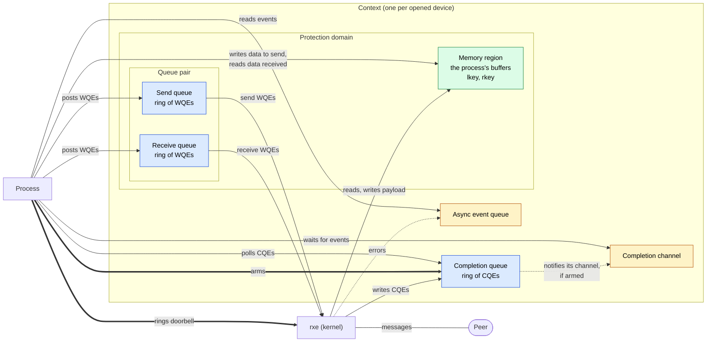

# rxe

rxe (soft-RoCE, the kernel's `rdma_rxe` driver) implements RDMA in software:
the kernel does what an RDMA NIC does in hardware, over an ordinary Ethernet
interface.

## Resources and how they interact

| Color | Resource | Memory |
|---|---|---|
| Blue | Send queue, receive queue, completion queue | Kernel memory **mapped into the process**. Both sides access the rings directly. |
| Green | Memory region | The **process's own memory**, pinned while registered so it can't move or be swapped out. |
| Yellow | Completion channel, async event queue | **File descriptors**. The process reads events from them, which blocks until one arrives. |

Thick arrows are kernel calls: ringing the send doorbell and arming the
completion queue. Everything else the process does is a plain memory access
or a read from a file descriptor.

## The resources

- **Context:** the process's handle on the device. It owns everything else,
  and closing it destroys everything.
- **Protection domain:** groups memory regions with the queue pairs allowed
  to use them. A queue pair can only reach memory regions of its own domain.
- **Memory region:** a registered buffer. The process writes the data it
  sends into it and reads the data it receives from it. Its **lkey** lets
  local WQEs name it, and its **rkey** lets the peer read, write or run
  atomics on it, if its access rights allow them.
- **Queue pair:** a send queue and a receive queue, each a ring of work queue
  entries (WQEs) that describe buffers in memory regions. A connected queue
  pair talks to exactly one queue pair on the peer.
- **Completion queue:** a ring where rxe reports finished WQEs as completion
  queue entries (CQEs). A queue pair's two queues may share one completion
  queue or use two.
- **Completion channel:** reports which armed completion queue has new
  entries, so the process can sleep instead of polling. A completion queue
  is attached to its channel when it is created.
- **Async event queue:** reports problems that belong to no single WQE, such
  as a queue pair entering the error state.

## How work flows

- **Posting** writes WQEs into the queue's ring. For the send queue, the
  process then rings a **doorbell**, the only part of posting that enters
  the kernel, to tell rxe there is work.
- **Send WQEs:** rxe reads the payload from the memory region and sends it
  to the peer, then writes a CQE once the peer has it.
- **Incoming sends** from the peer consume a receive WQE and land in its
  buffer, and rxe writes a CQE for the receive.
- **Incoming RDMA writes, reads and atomics** go straight to the memory
  region named by the rkey. They use no receive WQE and produce no CQE: the
  process is never involved. The exception is an RDMA write with immediate
  data, which also consumes a receive WQE and produces a CQE carrying that
  data.
- **Polling** reads CQEs from the completion queue's ring, with no kernel
  call.

## Waiting for completions

A process either polls its completion queue in a loop, which costs a CPU
core, or sleeps on the completion channel:

1. **Arm** the completion queue: the process asks rxe, with a kernel call,
   to report the queue's next CQE on the completion channel.
2. **Poll** once more, to catch CQEs that arrived before arming. They
   produced no event.
3. **Wait** on the completion channel until it reports the completion queue.
4. **Poll** to drain the completion queue, then arm again: an armed
   completion queue fires only once.

If a queue pair fails, it moves to the error state, its outstanding WQEs
complete with an error status, and the async event queue reports the error.
